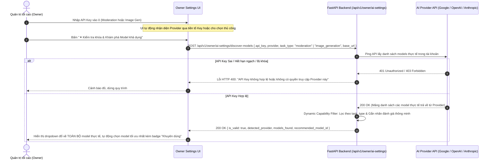
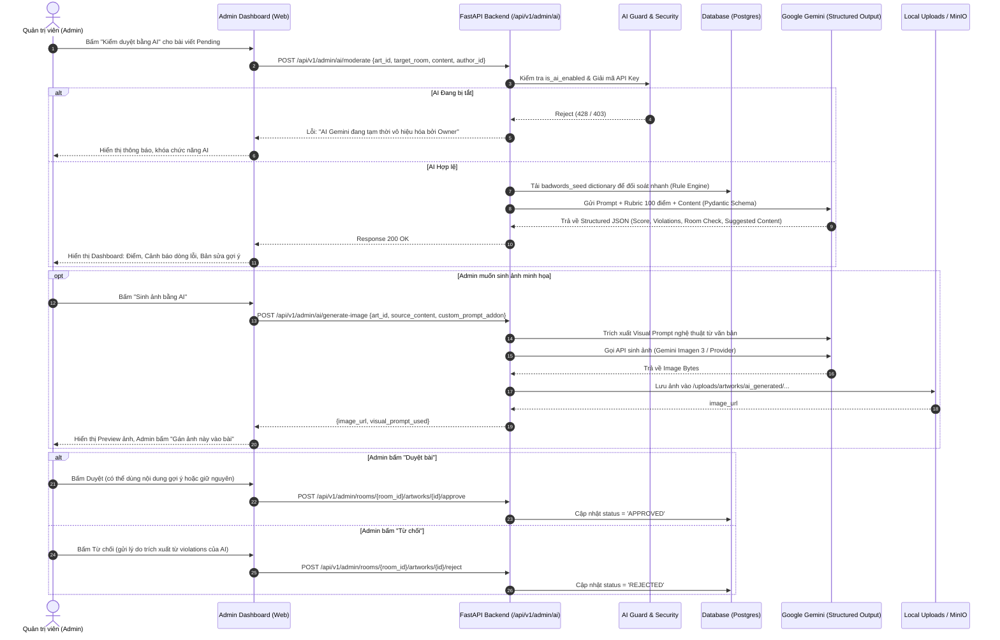

# PLAN 16 — HỆ THỐNG AI COPILOT DUYỆT BÀI VÀ SINH ẢNH CHO ADMIN DASHBOARD (HUMAN-IN-THE-LOOP)

> **Tài liệu đặc tả kiến trúc & kế hoạch triển khai (RFC & Implementation Plan)**  
> **Phạm vi**: Backend Module FastAPI + Gemini AI Copilot + Owner AI Toggle & Security + Badwords Matching Engine + Structured Outputs.  
> **Nguyên tắc cốt lõi**: **Human-in-the-loop (HITL)** — AI chỉ đóng vai trò phân tích, chấm điểm, đưa ra dẫn chứng và đề xuất; toàn bộ quyền duyệt (`APPROVED`), từ chối (`REJECTED`) hoặc sửa đổi bài viết vẫn thuộc về Quản trị viên (Admin).

---

## 1. TỔNG QUAN & MỤC TIÊU HỆ THỐNG

### 1.1. Bối cảnh & Thách thức
Hệ thống Exhibition Diary Platform bao gồm 3 phòng trưng bày nghệ thuật cảm xúc:
- **Phòng 01 (Broken Exhibition)**: Trưng bày nỗi đau, sự đổ vỡ, bài học chữa lành từ quá khứ.
- **Phòng 02 (Lantern Sky)**: Bầu trời hy vọng, ước nguyện tương lai tích cực, lời nhắn nhủ gửi tới mai sau.
- **Phòng 03 (Wish Tree)**: Cây thông điệp cộng đồng, sẻ chia suy nghĩ tích cực và nâng đỡ tinh thần.

Khi số lượng bài viết của người dùng gửi lên ở trạng thái chờ duyệt (`PENDING`) tăng cao, Admin gặp phải các khó khăn:
1. Mất nhiều thời gian đọc soát thủ công các vi phạm tiềm ẩn (lộ thông tin cá nhân PII, từ ngữ tục tĩu lách luật, quảng cáo rác).
2. Phân loại nhầm phòng (ví dụ: nội dung độc hại, cờ bạc đưa vào phòng hy vọng; hoặc bài viết nhật ký riêng tư cá nhân gửi nhầm vào phòng trưng bày triển lãm công cộng).
3. Thiếu hình ảnh minh họa cảm xúc phù hợp với tâm trạng bài viết (các bài viết không đính kèm media hoặc hình ảnh không đúng chủ đề).

### 1.2. Giải pháp: AI Copilot Assistant
Xây dựng trợ lý AI Copilot tích hợp vào Admin Dashboard với 2 tính năng chính:
1. **AI Content Inspector & Rubric Scorer**: Chấm điểm bài viết trên thang 100 điểm, trích dẫn chi tiết số dòng vi phạm, phân tích độ phù hợp của phòng (`Room Assessment`), và gợi ý bản viết lại trung tính chuẩn mực (`Suggested Content`) tuân thủ nghiêm ngặt nguyên tắc **Strict No-Hallucination**.
2. **AI Art Image Generator**: Trích xuất visual prompt (phong cách, cảm xúc, không gian, màu sắc chủ đạo) từ tác phẩm và gọi engine sinh ảnh nghệ thuật chất lượng cao, tải lên kho lưu trữ và cung cấp URL xem trước cho Admin gắn vào bài viết trước khi duyệt.
3. **Owner Master Control & Zero-Trust Security**: Owner có toàn quyền bật/tắt module AI toàn hệ thống, cấu hình Gemini API Key được mã hóa AES-256 trong Database. Mọi API AI đều được bảo vệ bởi guard middleware.

---

## 2. TIÊU CHÍ VÀ THANG ĐIỂM ĐÁNH GIÁ (RUBRIC: 100 ĐIỂM)

Hệ thống bắt đầu từ điểm cơ sở **100 điểm**. AI Copilot và Rule Engine phối hợp trừ điểm theo 8 nhóm vi phạm dưới đây. Mỗi lỗi trừ điểm **bắt buộc** phải cung cấp đầy đủ: `category`, `deducted_points`, `line_number`, `quote` (trích dẫn chính xác), và `reason` (giải thích).

| STT | Nhóm vi phạm | Mức phạt điểm | Mô tả chi tiết & Căn cứ xác định |
|---|---|---|---|
| **1** | **Lộ thông tin cá nhân (PII)** | **-25 điểm** | Số điện thoại, địa chỉ nhà riêng, CCCD/CMND, số tài khoản ngân hàng, link mạng xã hội cá nhân (FB, Zalo, Telegram, TikTok). |
| **2** | **Quảng cáo / PR trá hình** | **-20 điểm** | Bán hàng, kinh doanh, tuyển dụng đa cấp, tài xỉu/cờ bạc, link tiếp thị liên kết (affiliate), seeding dịch vụ thương mại. |
| **3** | **Đăng sai chuyên mục (Room Mismatch)** | **-15 điểm** | • Nội dung quá tiêu cực/toxic/oán hận gửi vào Room 2 (Bầu trời Hy Vọng) hoặc Room 3 (Cây Thông Điệp).<br>• Nội dung thuần nhật ký cá nhân (diary riêng tư không có tính nghệ thuật/sẻ chia cộng đồng) gửi vào các Exhibition Rooms.<br>• Nội dung hy vọng tương lai nhưng gửi vào Room 1 (Đổ vỡ). |
| **4** | **Nội dung thù địch, kích động, tự hại** | **-15 điểm** | Kêu gọi tự tử/tự làm hại bản thân, miệt thị vùng miền/dân tộc, quấy rối, bạo lực ngôn từ mức độ nghiêm trọng. |
| **5** | **Ngôn từ thô tục theo từ điển cấm** | **-15 điểm** | Trùng khớp từ vựng trong bảng từ cấm (Từ gốc, teencode, leet code, viết tắt, ký tự thay thế như `đ.m`, `vcl`, `l0n`, `f*ck`, `b!tch`). |
| **6** | **Ngôn từ thô tục do AI phát hiện ngữ cảnh** | **-10 điểm** | Các từ lóng mới, biến thể né filter tinh vi, châm biếm sâu cay, miệt thị gián tiếp do LLM phân tích ngữ nghĩa theo ngữ cảnh phát hiện. |
| **7** | **Nội dung SPAM / Vô nghĩa** | **-10 điểm** | Lặp từ vô nghĩa, chuỗi ký tự bàn phím ngẫu nhiên (`asdfgh`, `aaaaaa`), spam emoji dày đặc, văn bản không có nội dung rõ ràng. |
| **8** | **Bản quyền / Vi phạm chính sách khác** | **-5 điểm** | Sao chép nguyên văn tác phẩm thương mại, lời bài hát nổi tiếng không đề nguồn, vi phạm thuần phong mỹ tục khác. |

---

## 3. QUY TẮC PHÁN QUYẾT & REWRITE GỢI Ý (SUGGESTED CONTENT)

### 3.1. Phán quyết đề xuất (Verdict Recommendation)
- **Điểm Tổng $\ge 60$**: Đề xuất `APPROVE_WITH_EDITS` (Bài viết có thể duyệt sau khi Admin chỉnh sửa nhỏ theo gợi ý của AI).
- **Điểm Tổng $< 60$**: Đề xuất `DISAPPROVE` (Bài viết vi phạm nặng hoặc chất lượng kém, đề xuất từ chối kèm lý do phản hồi cho tác giả).

### 3.2. Ràng buộc cốt lõi (Strict No-Hallucination)
Bản `suggested_content` được sinh ra phải tuân thủ nghiêm ngặt các nguyên tắc:
1. **Không thêm ý mới**: Tuyệt đối không bịa đặt thêm tình tiết, nhân vật, bối cảnh hay triết lý ngoài văn bản gốc của tác giả.
2. **Làm sạch vi phạm**:
   - Thay thế từ ngữ thô tục thành từ vựng trung tính, giàu cảm xúc và văn minh hơn (ví dụ: *"đau như chó"* $\rightarrow$ *"vô cùng đau đớn"*).
   - Che giấu / Ẩn thông tin cá nhân PII (ví dụ: `0981234567` $\rightarrow$ `098***`, link FB $\rightarrow$ `[đã ẩn liên kết cá nhân]`).
   - Điều chỉnh đại từ xưng hô tôn trọng, sửa lỗi chính tả và ngữ pháp câu cú.
3. **Bảo toàn phong cách & Cấu trúc gốc**: Giữ nguyên mạch cảm xúc, độ dài tương đương và ý đồ chân thực của tác giả.

---

## 4. QUẢN LÝ QUYỀN OWNER: KIẾN TRÚC MULTI-PROVIDER TÁCH BIỆT & CƠ CHẾ KHÁM PHÁ MODEL ĐỘNG

> **Nguyên tắc thiết kế mở (Decoupled & Open Architecture):**  
> 1. **Tách biệt hoàn toàn 2 tác vụ**: Kiểm duyệt văn bản (Text Moderation) và Sinh ảnh nghệ thuật (Image Generation) có thể dùng **2 API Key riêng biệt** và **2 Provider hoàn toàn khác nhau** (ví dụ: Soát chữ dùng OpenAI `gpt-4o-mini` hoặc Anthropic `claude-3-5-sonnet`, trong khi Sinh ảnh dùng Google Imagen `imagen-3.0-generate-002` hoặc DALL-E 3).  
> 2. **Không áp đặt danh sách tĩnh (No Hardcoded Models)**: Không thể đoán trước tài khoản của Owner có quyền truy cập những model nào. Hệ thống sẽ **gọi trực tiếp vào API của Provider** bằng API Key vừa nhập để quét và phân tích năng lực thực tế, sau đó tự động lọc và gợi ý các model phù hợp nhất cho từng tác vụ.

---

### 4.1. Bảng cơ sở dữ liệu `ai_provider_settings` (Tách biệt 2 Dịch vụ)

```sql
CREATE TABLE IF NOT EXISTS ai_provider_settings (
    id VARCHAR(36) PRIMARY KEY,
    -- Công tắc tổng toàn hệ thống
    is_ai_enabled BOOLEAN NOT NULL DEFAULT FALSE,

    -- =========================================================================
    -- 1. CẤU HÌNH DỊCH VỤ KIỂM DUYỆT VĂN BẢN (TEXT MODERATION & RUBRIC SCORER)
    -- =========================================================================
    is_moderation_enabled BOOLEAN NOT NULL DEFAULT TRUE,
    moderation_provider VARCHAR(50) NOT NULL DEFAULT 'gemini', -- 'gemini', 'openai', 'anthropic', 'custom'
    moderation_base_url VARCHAR(255) NULL, -- Custom endpoint / proxy (nếu dùng self-hosted / vLLM / Groq)
    moderation_encrypted_api_key TEXT NULL, -- Khóa AES-256 riêng cho kiểm duyệt
    moderation_model_name VARCHAR(100) NULL, -- Model do Owner chọn từ danh sách quét thực tế

    -- =========================================================================
    -- 2. CẤU HÌNH DỊCH VỤ SINH ẢNH NGHỆ THUẬT (ART IMAGE GENERATION)
    -- =========================================================================
    is_image_gen_enabled BOOLEAN NOT NULL DEFAULT TRUE,
    image_provider VARCHAR(50) NOT NULL DEFAULT 'gemini', -- 'gemini', 'openai', 'stability', 'custom'
    image_base_url VARCHAR(255) NULL, -- Custom endpoint / proxy
    image_encrypted_api_key TEXT NULL, -- Khóa AES-256 riêng cho sinh ảnh
    image_model_name VARCHAR(100) NULL, -- Model do Owner chọn từ danh sách quét thực tế

    -- Tham số cấu hình nâng cao
    max_tokens_per_req INTEGER NOT NULL DEFAULT 2048,
    temperature NUMERIC(3,2) NOT NULL DEFAULT 0.20,
    updated_by_user_id VARCHAR(36) NULL REFERENCES users(id) ON DELETE SET NULL,
    created_at TIMESTAMP WITH TIME ZONE NOT NULL DEFAULT CURRENT_TIMESTAMP,
    updated_at TIMESTAMP WITH TIME ZONE NOT NULL DEFAULT CURRENT_TIMESTAMP
);
```

---

### 4.2. Cơ chế Khám phá Model Động từ API Thực tế (Dynamic Model Discovery Engine)

Khi Owner nhập API Key vào ô cấu hình (ô Kiểm duyệt hoặc ô Sinh ảnh), hệ thống không dùng danh sách cứng mà thực hiện quy trình khám phá thời gian thực:



#### Chi tiết Quy trình Xử lý của Backend (`discover-models`):

1. **Tự động nhận diện Provider (Auto Provider Detection)**:
   - Bắt đầu bằng `AIza...` hoặc `AQ.` (Google AI Studio / Vertex / Gemini Developer API) $\rightarrow$ Provider: `gemini` (Google Generative AI).
   - Bắt đầu bằng `sk-...` hoặc `sk-proj-...` $\rightarrow$ Provider: `openai` (OpenAI Platform).
   - Bắt đầu bằng `sk-ant-...` $\rightarrow$ Provider: `anthropic` (Anthropic Claude).
   - Khác $\rightarrow$ Cho phép Owner chọn thủ công (`gemini`, `openai`, `anthropic`, `custom`).


2. **Giao thức gọi API thực tế của từng Provider**:
   - **Google Gemini / Imagen**:
     - Endpoint: `GET https://generativelanguage.googleapis.com/v1beta/models?key={api_key}`
     - Dữ liệu trả về: Mảng `models` chứa `name`, `supportedGenerationMethods`, `displayName`, `description`.
   - **OpenAI (hoặc OpenAI-Compatible)**:
     - Endpoint: `GET {base_url or https://api.openai.com}/v1/models`
     - Header: `Authorization: Bearer {api_key}`
     - Dữ liệu trả về: Mảng `data` chứa các model ID (`gpt-4o`, `gpt-4o-mini`, `dall-e-3`,...).
   - **Anthropic**:
     - Endpoint: `GET https://api.anthropic.com/v1/models`
     - Header: `x-api-key: {api_key}`, `anthropic-version: 2023-06-01`.

3. **Thuật toán Lọc năng lực & Xếp hạng Khuyến nghị Động (Dynamic Capability & Ranking)**:
   Dựa trên danh sách **thực sự tồn tại** trong tài khoản của Owner, backend lọc theo `task_type`:

   - **A. Khi `task_type = "moderation"` (Kiểm duyệt & Chấm điểm văn bản)**:
     - Loại bỏ các model không hỗ trợ chat/văn bản (loại embedding, tts, whisper, dall-e).
     - **Google**: Lọc các model có `generateContent` trong `supportedGenerationMethods`.
       - *Thứ tự ưu tiên khuyến nghị động*: Tìm model mới nhất có `2.5-flash` $\rightarrow$ `2.0-flash` $\rightarrow$ `1.5-flash` $\rightarrow$ `1.5-pro`. (Ưu tiên Flash vì tốc độ và độ tuân thủ JSON Schema).
     - **OpenAI**: Lọc các model có ID chứa `gpt-4o`, `gpt-4`, `o1`.
       - *Thứ tự ưu tiên khuyến nghị động*: Ưu tiên `gpt-4o-mini` (nhanh, chi phí cực thấp, tuân thủ strict json tốt) $\rightarrow$ `gpt-4o` $\rightarrow$ `gpt-4-turbo`.
     - **Anthropic**: Lọc các model `claude-3-5-sonnet`, `claude-3-haiku`.
       - *Thứ tự ưu tiên khuyến nghị động*: `claude-3-5-sonnet` $\rightarrow$ `claude-3-haiku`.
     - **Custom Provider**: Lấy toàn bộ chat models, gán gợi ý cho model đầu tiên có chứa `chat` hoặc `instruct`.

   - **B. Khi `task_type = "image_generation"` (Sinh ảnh nghệ thuật)**:
     - Lọc các model có năng lực sinh hình ảnh:
     - **Google**: Tìm các model chứa `imagen` (ví dụ: `imagen-3.0-generate-002`, `imagen-3.0-fast-generate-001`, `image-generation-005`).
       - *Thứ tự ưu tiên khuyến nghị động*: Ưu tiên `imagen-3.0-generate-002` (chất lượng mỹ thuật cao nhất).
     - **OpenAI**: Tìm các model chứa `dall-e` (ví dụ: `dall-e-3`, `dall-e-2`).
       - *Thứ tự ưu tiên khuyến nghị động*: Ưu tiên `dall-e-3`.
     - **Stability / Custom**: Tìm các model `sd3`, `flux`, `stable-diffusion`.

---

### 4.3. Kiến trúc Adapter Pattern Đa Nền Tảng (Multi-Provider Architecture)

Hệ thống xây dựng theo mô hình Adapter độc lập, không phụ thuộc cứng vào bất kỳ nhà cung cấp AI nào:

```text
app/services/ai/
├── base_moderator.py          # Abstract Base Class cho kiểm duyệt
├── base_image_generator.py     # Abstract Base Class cho sinh ảnh
├── moderators/
│   ├── gemini_moderator.py    # Xử lý gọi Google Gemini SDK / REST
│   ├── openai_moderator.py    # Xử lý gọi OpenAI SDK / REST
│   └── anthropic_moderator.py # Xử lý gọi Anthropic API
└── image_generators/
    ├── imagen_generator.py    # Xử lý sinh ảnh qua Google Imagen 3
    ├── dalle_generator.py     # Xử lý sinh ảnh qua OpenAI DALL-E 3
    └── stability_generator.py # Xử lý sinh ảnh qua Stability AI / Flux
```

Mỗi Adapter đảm bảo thực hiện đúng Interface chuẩn:
- `ModeratorAdapter.moderate(content, target_room, rubric) -> ModerationResultSchema`
- `ImageGeneratorAdapter.generate(visual_prompt, dimensions) -> ImageResultBytes`

---

### 4.4. Cơ chế Mã hóa AES-256 Độc lập & Bảo mật Khóa
- Cả 2 khóa `moderation_encrypted_api_key` và `image_encrypted_api_key` được mã hóa độc lập bằng AES-256-GCM với IV và Salt riêng biệt trước khi lưu vào database.
- Khi Owner xem cấu hình: API chỉ trả về trạng thái cấu hình (`is_moderation_key_configured: true/false`, `is_image_key_configured: true/false`) và chuỗi mặt nạ (ví dụ: `sk-...9Z1a`, `AIza...4AbC`).
- Tuyệt đối không bao giờ trả về API key gốc cho client.

---

### 4.5. Middleware Guard Độc lập cho từng Dịch vụ
- **Duyệt bài (`/api/v1/admin/ai/moderate`)**:
  - Chỉ yêu cầu: `is_ai_enabled == true` VÀ `is_moderation_enabled == true` VÀ có key kiểm duyệt hợp lệ.
  - Nếu thiếu: Trả về HTTP 428/403 kèm message rõ ràng: *"Dịch vụ AI Kiểm duyệt đang tạm thời tắt hoặc chưa được cấu hình API Key bởi Owner"*.
- **Sinh ảnh (`/api/v1/admin/ai/generate-image`)**:
  - Chỉ yêu cầu: `is_ai_enabled == true` VÀ `is_image_gen_enabled == true` VÀ có key sinh ảnh hợp lệ.
  - Nếu thiếu: Trả về HTTP 428/403 kèm message: *"Dịch vụ AI Sinh ảnh đang tạm thời tắt hoặc chưa được cấu hình API Key bởi Owner"*.
- **Tính độc lập cao**: Owner có thể bật chỉ kiểm duyệt (dùng OpenAI) mà không cần bật sinh ảnh, hoặc bật cả hai với 2 key của 2 hãng khác nhau.


---

## 5. THIẾT KẾ CSDL BẢNG TỪ CẤM (`bad_words`) & SEED DATA

### 5.1. Bảng `bad_words`
```sql
CREATE TABLE IF NOT EXISTS bad_words (
    id VARCHAR(36) PRIMARY KEY,
    term VARCHAR(100) NOT NULL,
    language VARCHAR(10) NOT NULL DEFAULT 'vi', -- 'vi', 'en'
    category VARCHAR(50) NOT NULL, -- 'profanity_severe', 'insult_intellect', 'derogatory_sexual', 'hate_speech', 'profanity_mild'
    base_penalty INTEGER NOT NULL DEFAULT 15,
    variants JSONB NOT NULL DEFAULT '[]'::jsonb,
    is_active BOOLEAN NOT NULL DEFAULT TRUE,
    created_at TIMESTAMP WITH TIME ZONE NOT NULL DEFAULT CURRENT_TIMESTAMP,
    updated_at TIMESTAMP WITH TIME ZONE NOT NULL DEFAULT CURRENT_TIMESTAMP
);

CREATE INDEX idx_bad_words_term ON bad_words(term);
CREATE INDEX idx_bad_words_category ON bad_words(category);
```

### 5.2. File Seed Dictionary
File `database/badwords_seed.json` chứa tập hợp từ vựng và biến thể leet/teencode tiếng Việt và tiếng Anh (đã tạo tại [badwords_seed.json](file:///e:/Hcmut%20material/Business_Communication/Project_exhibition_diary_platform/backend/database/badwords_seed.json)).

---

## 6. QUY TRÌNH HOẠT ĐỘNG (FLOW DIAGRAM & HUMAN-IN-THE-LOOP)



---

## 7. CHI TIẾT CÁC ENDPOINT API

### 7.1. Phân nhóm API Kiểm duyệt & Sinh ảnh (`Admin`)
Router: `APIRouter(prefix="/admin/ai", tags=["Admin - AI Copilot"])`

#### A. Endpoint Kiểm duyệt nội dung (`Inspect & Moderate`)
- **Method & Path**: `POST /api/v1/admin/ai/moderate`
- **Quyền**: `ADMIN` hoặc `OWNER` (`Depends(require_admin)`).
- **Middleware Guard**: `Depends(require_ai_enabled)`.
- **Request Body**:
  ```json
  {
    "art_id": "9c8b7a6f-5e4d-3c2b-1a0f-987654321fed",
    "target_room": "room1",
    "content": "Hôm nay em buồn vl, chia tay thằng nyc cờ bạc nợ nần. Ai cần vay tiền liên hệ 0981234567 nha.",
    "author_id": "u-12345"
  }
  ```
- **Response 200 OK** (Structured JSON):
  ```json
  {
    "success": true,
    "data": {
      "art_id": "9c8b7a6f-5e4d-3c2b-1a0f-987654321fed",
      "score": 40,
      "verdict_recommendation": "DISAPPROVE",
      "violations": [
        {
          "category": "pii",
          "deducted_points": 25,
          "line_number": 1,
          "quote": "0981234567",
          "reason": "Lộ số điện thoại liên lạc cá nhân"
        },
        {
          "category": "advertising",
          "deducted_points": 20,
          "line_number": 1,
          "quote": "Ai cần vay tiền liên hệ",
          "reason": "Nội dung quảng cáo cho vay tài chính / thương mại"
        },
        {
          "category": "profanity_dictionary",
          "deducted_points": 15,
          "line_number": 1,
          "quote": "vl",
          "reason": "Sử dụng từ ngữ tục tĩu viết tắt (vl)"
        }
      ],
      "room_assessment": {
        "current_room": "room1",
        "is_valid": true,
        "suggested_room": "room1",
        "reason": "Chủ đề mất mát tình cảm phù hợp với Phòng Đổ Vỡ, tuy nhiên vi phạm nặng về PII và quảng cáo."
      },
      "suggested_content": "Hôm nay tôi rất buồn, chia tay người yêu cũ vì những bất đồng tài chính. [Đã ẩn thông tin liên hệ và quảng cáo vay mượn]."
    }
  }
  ```

#### B. Endpoint Sinh ảnh minh họa (`Generate Art Image`)
- **Method & Path**: `POST /api/v1/admin/ai/generate-image`
- **Quyền**: `ADMIN` hoặc `OWNER`.
- **Request Body**:
  ```json
  {
    "art_id": "9c8b7a6f-5e4d-3c2b-1a0f-987654321fed",
    "source_content": "Tôi nhặt từng mảnh vỡ của chiếc ly kỷ niệm dưới ánh hoàng hôn mùa đông...",
    "custom_prompt_addon": "watercolor style, warm melancholic lighting, high detail"
  }
  ```
- **Xử lý Backend**:
  1. Trích xuất visual concept qua Gemini: Chuyển hóa cảm xúc văn học thành visual prompt tiếng Anh tối ưu cho engine sinh ảnh.
  2. Sinh ảnh qua Imagen / Model API với timeout 30s.
  3. Tải ảnh về và lưu vào hệ thống storage cục bộ hoặc S3/MinIO.
- **Response 200 OK**:
  ```json
  {
    "success": true,
    "data": {
      "art_id": "9c8b7a6f-5e4d-3c2b-1a0f-987654321fed",
      "image_url": "/uploads/artworks/ai_generated/art_9c8b7a6f_20261026_231900.webp",
      "visual_prompt": "A delicate shattered ceramic glass on wooden floor, sunset light beam passing through winter window, watercolor aesthetic, deep emotional solitude",
      "width": 1024,
      "height": 1024
    }
  }
  ```

---

### 7.2. Phân nhóm API Quản trị Cấu hình AI (`Owner`)
Router: `APIRouter(prefix="/owner/ai-settings", tags=["Owner - AI Configuration"])`
- Toàn bộ nhóm này bắt buộc quyền **OWNER** (`Depends(require_owner)`).

| Method | Path | Mô tả |
|---|---|---|
| `GET` | `/api/v1/owner/ai-settings` | Lấy toàn bộ cấu hình hiện tại: trạng thái công tắc tổng, chi tiết độc lập của dịch vụ Kiểm duyệt (Moderation) và Sinh ảnh (Image Gen) kèm key đã mask. |
| `POST` | `/api/v1/owner/ai-settings/discover-models` | **Khám phá Model Động**: Nhận API Key (OpenAI, Gemini, Anthropic hoặc Custom), ping trực tiếp API của Provider để lấy danh sách models thật và xếp hạng gợi ý theo `task_type`. |
| `PUT` | `/api/v1/owner/ai-settings` | Cập nhật cấu hình: Bật/tắt AI tổng, cập nhật độc lập cấu hình Kiểm duyệt hoặc Sinh ảnh (Mã hóa AES-256 từng key riêng). |
| `POST` / `PATCH` | `/api/v1/owner/ai-settings/activate` (alias: `/enable`) | **Kích hoạt Dịch vụ AI**: Bật công tắc tổng toàn hệ thống (`is_ai_enabled = true`) hoặc bật riêng từng dịch vụ con (`moderation` / `image_generation`). |
| `POST` / `PATCH` | `/api/v1/owner/ai-settings/deactivate` (alias: `/disable`) | **Vô hiệu hóa Dịch vụ AI**: Tắt công tắc tổng toàn hệ thống (`is_ai_enabled = false`) hoặc tắt riêng từng dịch vụ con (`moderation` / `image_generation`). |
| `DELETE` | `/api/v1/owner/ai-settings/api-key/moderation` | **Xóa API Key Kiểm duyệt**: Xóa khóa API đã lưu của dịch vụ kiểm duyệt nội dung, đưa `is_key_configured` về `false`. |
| `DELETE` | `/api/v1/owner/ai-settings/api-key/image-generation` | **Xóa API Key Sinh ảnh**: Xóa khóa API đã lưu của dịch vụ sinh ảnh nghệ thuật, đưa `is_key_configured` về `false`. |

#### A. Endpoint Khám phá Model Động (`POST /api/v1/owner/ai-settings/discover-models`)


- **Request Body**:
  ```json
  {
    "api_key": "sk-proj-abc123xyz...",
    "provider": "auto",
    "task_type": "moderation",
    "base_url": null
  }
  ```
- **Response 200 OK (Ví dụ khi Owner nhập API Key của OpenAI)**:
  ```json
  {
    "success": true,
    "data": {
      "is_valid": true,
      "detected_provider": "openai",
      "task_type": "moderation",
      "total_models_in_account": 24,
      "recommended_model_id": "gpt-4o-mini",
      "discovered_models": [
        {
          "id": "gpt-4o-mini",
          "display_name": "GPT-4o Mini",
          "is_recommended": true,
          "badge": "Khuyên dùng số 1",
          "reason": "Phản hồi cực nhanh, chi phí siêu rẻ, tuân thủ định dạng JSON Schema kiểm duyệt hoàn hảo."
        },
        {
          "id": "gpt-4o",
          "display_name": "GPT-4o",
          "is_recommended": false,
          "badge": "Đa phương thức mạnh mẽ",
          "reason": "Suy luận cao cấp nhất của OpenAI, phù hợp phân tích văn phong phức tạp."
        },
        {
          "id": "gpt-4-turbo",
          "display_name": "GPT-4 Turbo",
          "is_recommended": false,
          "badge": "Tiêu chuẩn",
          "reason": "Mô hình GPT-4 tiền nhiệm."
        }
      ]
    }
  }
  ```
- **Response 200 OK (Ví dụ khi Owner nhập API Key của Google Gemini cho tác vụ Sinh ảnh)**:
  ```json
  {
    "success": true,
    "data": {
      "is_valid": true,
      "detected_provider": "gemini",
      "task_type": "image_generation",
      "total_models_in_account": 16,
      "recommended_model_id": "imagen-3.0-generate-002",
      "discovered_models": [
        {
          "id": "imagen-3.0-generate-002",
          "display_name": "Imagen 3.0 Generate",
          "is_recommended": true,
          "badge": "Khuyên dùng số 1",
          "reason": "Chất lượng hình ảnh nghệ thuật tinh xảo, bám sát visual prompt trích xuất từ tác phẩm."
        },
        {
          "id": "imagen-3.0-fast-generate-001",
          "display_name": "Imagen 3.0 Fast",
          "is_recommended": false,
          "badge": "Tốc độ cao",
          "reason": "Sinh ảnh tức thì trong ~2s."
        }
      ]
    }
  }
  ```
- **Response 400 Bad Request (API Key không hợp lệ / Hết hạn ngạch)**:
  ```json
  {
    "success": false,
    "error": {
      "code": "API_KEY_INVALID",
      "message": "Không thể xác thực API Key với Provider (OpenAI/Google). Vui lòng kiểm tra lại key hoặc hạn ngạch tài khoản."
    }
  }
  ```

#### B. Endpoint Lấy Cấu hình Hiện tại (`GET /api/v1/owner/ai-settings`)
- **Response 200 OK**:
  ```json
  {
    "success": true,
    "data": {
      "is_ai_enabled": true,
      "moderation": {
        "is_enabled": true,
        "provider": "openai",
        "is_key_configured": true,
        "masked_api_key": "sk-proj...9AbC",
        "model_name": "gpt-4o-mini",
        "base_url": null
      },
      "image_generation": {
        "is_enabled": true,
        "provider": "gemini",
        "is_key_configured": true,
        "masked_api_key": "AIzaSy...4XyZ",
        "model_name": "imagen-3.0-generate-002",
        "base_url": null
      }
    }
  }
  ```

#### C. Endpoint Cập nhật Cấu hình AI Độc lập (`PUT /api/v1/owner/ai-settings`)
- **Request Body**:
  ```json
  {
    "is_ai_enabled": true,
    "moderation": {
      "is_enabled": true,
      "provider": "openai",
      "api_key": "sk-proj-new-key...", // Optional nếu không thay đổi
      "model_name": "gpt-4o-mini",
      "base_url": null
    },
    "image_generation": {
      "is_enabled": true,
      "provider": "gemini",
      "api_key": "AIzaSy-new-key...", // Optional nếu không thay đổi
      "model_name": "imagen-3.0-generate-002",
      "base_url": null
    }
  }
  ```
- **Xử lý Backend**:
  1. Nếu có `api_key` mới: Chạy validation tự động tương ứng với `provider` của dịch vụ đó.
  2. Mã hóa AES-256 độc lập cho từng key và lưu vào các cột tương ứng trong database.
  3. Ghi nhận `updated_by_user_id = current_owner.id`.


---

## 8. SYSTEM PROMPT & STRUCTURED OUTPUT SCHEMA (PYDANTIC)

### 8.1. Pydantic Structured Output Schema
```python
from typing import List, Literal, Optional
from pydantic import BaseModel, Field

class ViolationDetail(BaseModel):
    category: Literal[
        "pii",
        "advertising",
        "room_mismatch",
        "hate_speech",
        "profanity_dictionary",
        "profanity_contextual",
        "spam",
        "copyright_policy"
    ] = Field(description="Mã phân loại vi phạm theo Rubric")
    deducted_points: int = Field(ge=5, le=30, description="Số điểm bị trừ cho vi phạm này")
    line_number: int = Field(ge=1, description="Dòng xảy ra vi phạm (1-indexed)")
    quote: str = Field(description="Trích dẫn chính xác nguyên văn đoạn vi phạm từ văn bản gốc")
    reason: str = Field(description="Giải thích rõ ràng lý do vi phạm quy chuẩn cộng đồng")

class RoomAssessment(BaseModel):
    current_room: Literal["room1", "room2", "room3"]
    is_valid: bool = Field(description="Phòng hiện tại có phù hợp với cảm xúc bài viết không")
    suggested_room: Literal["room1", "room2", "room3"] = Field(description="Phòng phù hợp nhất theo phân tích cảm xúc")
    reason: str = Field(description="Căn cứ đánh giá phòng phù hợp")

class ModerationResultSchema(BaseModel):
    art_id: str
    score: int = Field(ge=0, le=100, description="Điểm đánh giá từ 0 đến 100")
    verdict_recommendation: Literal["APPROVE_WITH_EDITS", "DISAPPROVE"]
    violations: List[ViolationDetail]
    room_assessment: RoomAssessment
    suggested_content: str = Field(
        description="Bản viết lại trung tính, giữ trọn vẹn ngữ nghĩa gốc, không thêm chi tiết mới (Strict No-Hallucination)"
    )
```

### 8.2. System Prompt Chuẩn Hóa
```text
Bạn là Trợ lý AI Copilot cao cấp phụ trách kiểm duyệt nội dung nghệ thuật cho nền tảng "Museum of Feelings Platform".
Nhiệm vụ của bạn là kiểm tra bài viết của người dùng đang chờ duyệt, tính điểm theo thang 100 điểm, phát hiện lỗi vi phạm một cách khách quan, nghiêm khắc và đề xuất bản viết lại trung tính.

CÁC NGUYÊN TẮC BẮT BUỘC:
1. ĐIỂM GỐC: 100 điểm. Trừ điểm chính xác theo Rubric:
   - PII (Lộ SĐT, CCCD, địa chỉ riêng, link MXH): -25 điểm.
   - Quảng cáo, buôn bán, cờ bạc, đa cấp, affiliate: -20 điểm.
   - Đăng sai phòng (Room Mismatch): -15 điểm.
     + Room 1 (Đổ Vỡ): Chấp nhận nỗi buồn, tan vỡ, mất mát. Không chấp nhận toxic kích động.
     + Room 2 (Bầu Trời Hy Vọng): Chỉ dành cho ước nguyện tích cực, tương lai, hy vọng. Từ chối nội dung cay đắng, oán hận, tiêu cực.
     + Room 3 (Cây Thông Điệp): Chia sẻ suy tư tích cực, kết nối cộng đồng.
   - Kêu gọi tự hại, thù ghét nhóm người, kích động bạo lực: -15 điểm.
   - Ngôn từ thô tục, chửi thề, teencode tục tĩu: -15 điểm.
   - Ngôn từ tiêu cực/xúc phạm ngữ cảnh: -10 điểm.
   - SPAM, vô nghĩa, spam ký tự/icon: -10 điểm.
   - Bản quyền / vi phạm chính sách khác: -5 điểm.

2. PHÁN QUYẾT:
   - Điểm >= 60: verdict_recommendation = "APPROVE_WITH_EDITS"
   - Điểm < 60: verdict_recommendation = "DISAPPROVE"

3. NGUYÊN TẮC STRICT NO-HALLUCINATION (CỰC KỲ QUAN TRỌNG):
   - Bản 'suggested_content' tuyệt đối KHÔNG ĐƯỢC thêm ý mới, không bịa chi tiết bên ngoài.
   - Chỉ được: Thay từ tục thành từ trung tính, ẩn số điện thoại (098***), điều chỉnh xưng hô, sửa lỗi chính tả ngữ pháp.
   - Giữ nguyên toàn bộ cấu trúc và ý nghĩa gốc của tác giả.

4. ĐỊNH DẠNG ĐẦU RA:
   - Trả về duy nhất dữ liệu JSON hợp lệ theo đúng cấu trúc Schema được yêu cầu, không thêm lời chào, không bọc markdown nếu dùng tool call.
```

---

## 9. DANH MỤC FILE CẦN TRIỂN KHAI TRONG BACKEND

1. **Database & Seed**:
   - `backend/database/badwords_seed.json` *(Đã tạo)*.
   - `backend/database/03_ai_copilot_schema.sql` (hoặc migration Alembic tạo bảng `ai_provider_settings` và `bad_words`).
2. **Core Security & Crypto**:
   - `backend/app/core/crypto.py`: Hàm `encrypt_aes_256(plain_text)` và `decrypt_aes_256(cipher_text)`.
3. **Schemas**:
   - `backend/app/schemas/ai_copilot.py`: Pydantic models cho request/response kiểm duyệt, sinh ảnh, và settings của Owner.
4. **Services**:
   - `backend/app/services/badwords_service.py`: Service load dictionary, tìm kiếm nhanh badwords (Aho-Corasick / Regex).
   - `backend/app/services/gemini_service.py`: Tương tác với Google Gemini API (Structured Outputs qua google-generativeai hoặc langchain).
   - `backend/app/services/ai_copilot_service.py`: Tổng hợp quy trình kiểm duyệt (Rule engine + Gemini reasoning), fallback an toàn.
   - `backend/app/services/image_generation_service.py`: Service trích xuất visual prompt và sinh ảnh.
5. **API Endpoints & Dependencies**:
   - `backend/app/api/deps_ai.py`: Dependency `require_ai_enabled`.
   - `backend/app/api/v1/endpoints/admin_ai.py`: Endpoint `/admin/ai/moderate` và `/admin/ai/generate-image`.
   - `backend/app/api/v1/endpoints/owner_ai.py`: Endpoint cấu hình AI cho Owner.
6. **Tests & Postman Collection**:
   - `backend/tests/test_ai_copilot.py`: Bộ kiểm thử toàn diện kịch bản kiểm duyệt, badwords engine, AI toggle guard, và dynamic multi-provider discovery *(Đã tạo)*.
   - `backend/postman_json/16_ai_copilot.postman_collection.json`: File Collection chuẩn Schema v2.1.0 import trực tiếp vào Postman để test toàn bộ các endpoint Owner & Admin AI *(Đã tạo)*.


---

## 10. KẾ HOẠCH BÀN GIAO & PHỐI HỢP FRONTEND (HITL UX)

- **Admin Room Management Table**:
  - Với mỗi bài `PENDING`, hiển thị nút `✦ AI Copilot Soát Bài`.
  - Khi nhấp vào, mở Drawer/Modal phân tích:
    - Vòng tròn điểm số (Score Badge): Xanh ($\ge 80$), Vàng ($60 - 79$), Đỏ ($< 60$).
    - Danh sách các câu vi phạm kèm highlight trong văn bản gốc.
    - Cột so sánh: Văn bản gốc ⇄ Bản viết lại gợi ý (`suggested_content`).
    - Nút bấm *"Sử dụng bản sửa đổi này"* (Tự động đưa `suggested_content` vào ô nội dung duyệt).
- **Trạng thái AI Disabled**:
  - Nếu Owner tắt AI, Admin Dashboard hiển thị thông báo dịu mắt và vô hiệu hóa nút AI, đảm bảo luồng duyệt thủ công vẫn vận hành 100% trơn tru không bị gián đoạn.
