# LỘ TRÌNH TỔNG QUAN TÍCH HỢP API FRONTEND
## The Name of Feeling Museum Platform

---

## 1. Giới thiệu
Bộ tài liệu đặc tả này quy định chi tiết quy trình kết nối giữa **Giao diện người dùng (Frontend React)** và **Hệ thống API máy chủ (Backend FastAPI & PostgreSQL)**. Mỗi màn hình giao diện của User, Admin và Owner đều được phân tách thành một tài liệu độc lập và sắp xếp theo **thứ tự thực thi ưu tiên từ 00 đến 12**.

---

## 2. Thứ tự Thực thi & Danh mục Tài liệu

| Thứ tự | Mã tệp tài liệu | Tên màn hình / Chức năng | Phân quyền | Nhóm API Backend |
|:---:|---|---|:---:|---|
| **00A** | [00_REQUIRED_ADDITIONAL_APIS.md](file:///e:/Hcmut%20material/Business_Communication/Project_exhibition_diary_platform/frontend/specification/00_REQUIRED_ADDITIONAL_APIS.md) | **Đặc tả các API cần bổ sung** (Gap Analysis & Backend Requirements) | Toàn hệ thống | API Mới cần làm |
| **00B** | [00_frontend_foundation_api_client.md](file:///e:/Hcmut%20material/Business_Communication/Project_exhibition_diary_platform/frontend/specification/00_frontend_foundation_api_client.md) | Cấu hình Base API Client, Interceptors & Xử lý lỗi toàn cục | Hệ thống | Toàn bộ API |
| **01** | [01_auth_pages.md](file:///e:/Hcmut%20material/Business_Communication/Project_exhibition_diary_platform/frontend/specification/01_auth_pages.md) | Màn hình Đăng nhập (A1), Đăng ký, Đổi/Quên mật khẩu, Đăng xuất | Public / Auth | Nhóm 1 (`/auth`) |
| **02** | [02_user_profile_page.md](file:///e:/Hcmut%20material/Business_Communication/Project_exhibition_diary_platform/frontend/specification/02_user_profile_page.md) | Trang Hồ sơ cá nhân, Đổi biệt danh, Đổi mật khẩu trong app, Avatar, Lưu theme | USER / ADMIN | Nhóm 2 (`/users/me`) |
| **03** | [03_lobby_shared_chrome.md](file:///e:/Hcmut%20material/Business_Communication/Project_exhibition_diary_platform/frontend/specification/03_lobby_shared_chrome.md) | Sảnh chính (B1), Hòm thư máy nhả thông điệp (B2), Hộp thông báo (B3), Bảng màu (B4) | USER / ADMIN | Nhóm 3 (`/capsules`), Nhóm 4 (`/notifications`) |
| **04** | [04_room1_broken_page.md](file:///e:/Hcmut%20material/Business_Communication/Project_exhibition_diary_platform/frontend/specification/04_room1_broken_page.md) | Phòng 1: Triển lãm Đổ vỡ (C1), Xem chi tiết (C2), Trưng bày (C3-C5), Tác phẩm của tôi (C6) | Public / USER | Nhóm 5 (`/rooms/1`) |
| **05** | [05_room2_hope_page.md](file:///e:/Hcmut%20material/Business_Communication/Project_exhibition_diary_platform/frontend/specification/05_room2_hope_page.md) | Phòng 2: Bầu trời Lồng đèn (D1), Thả lồng đèn hẹn giờ (D2), Lồng đèn hạ xuống mở thư & lưu sổ tay (D3) | Public / USER | Nhóm 6 (`/rooms/2`) |
| **06** | [06_room3_community_tree_page.md](file:///e:/Hcmut%20material/Business_Communication/Project_exhibition_diary_platform/frontend/specification/06_room3_community_tree_page.md) | Phòng 3: Cây Thông điệp (E1), Đọc lá nhận năng lượng (E2), Treo thông điệp lên cây (E3) | Public / USER | Nhóm 7 (`/rooms/3`) |
| **07** | [07_diary_pages.md](file:///e:/Hcmut%20material/Business_Communication/Project_exhibition_diary_platform/frontend/specification/07_diary_pages.md) | Không gian Nhật ký: Nhật ký Bản thân (G1), Nhật ký Cộng đồng (G2), Viết nhật ký mới (G3) | Public / USER | Nhóm 8 (`/diaries`) |
| **07B** | [07b_notebook_page.md](file:///e:/Hcmut%20material/Business_Communication/Project_exhibition_diary_platform/frontend/specification/07b_notebook_page.md) | **Sổ tay Ký ức**: Lưu trữ thông điệp Hòm thư & Bức thư lồng đèn Phòng 2 | USER | Nhóm 3 (`/capsules`) & Nhóm Mới (`/notebook`) |
| **08** | [08_admin_rooms_page.md](file:///e:/Hcmut%20material/Business_Communication/Project_exhibition_diary_platform/frontend/specification/08_admin_rooms_page.md) | Quản trị: Kiểm duyệt 3 phòng triển lãm, Upload tranh, Phê duyệt, Từ chối (H1-H3), Lưu trữ | ADMIN / OWNER | Nhóm 9 (`/admin/rooms`) |
| **09** | [09_admin_diaries_page.md](file:///e:/Hcmut%20material/Business_Communication/Project_exhibition_diary_platform/frontend/specification/09_admin_diaries_page.md) | Quản trị: Kiểm duyệt Nhật ký chia sẻ cộng đồng, Phê duyệt, Từ chối, Thu hồi về riêng tư | ADMIN / OWNER | Nhóm 10 (`/admin/diaries`) |
| **10** | [10_admin_capsules_page.md](file:///e:/Hcmut%20material/Business_Communication/Project_exhibition_diary_platform/frontend/specification/10_admin_capsules_page.md) | Quản trị: Quản lý Kho thông điệp hòm thư (H4), Bật/Tắt trạng thái, Thêm câu mới | ADMIN / OWNER | Nhóm 11 (`/admin/capsules`) |
| **11** | [11_admin_studio_audit_page.md](file:///e:/Hcmut%20material/Business_Communication/Project_exhibition_diary_platform/frontend/specification/11_admin_studio_audit_page.md) | Quản trị: Studio xuất bản trực tiếp, Nhật ký kiểm toán thao tác quản trị, Khóa tài khoản vi phạm | ADMIN / OWNER | Nhóm 12 (`/admin/studio`) |
| **12** | [12_owner_management_page.md](file:///e:/Hcmut%20material/Business_Communication/Project_exhibition_diary_platform/frontend/specification/12_owner_management_page.md) | Quản trị Tối cao của Chủ sở hữu: Quản lý phân quyền USER/ADMIN, Duyệt xóa vĩnh viễn tài khoản | Duy nhất OWNER | Nhóm 13 (`/owner`) |

---

## 3. Ma trận Phân quyền & Vai trò người dùng

```mermaid
graph TD
    User["USER (Người dùng thường)"] --> PublicView["Xem triển lãm, thả đèn, treo lá, rút hòm thư"]
    User --> PersonalAction["Viết nhật ký, đăng tác phẩm, thả cảm xúc"]
    
    Admin["ADMIN (Quản trị viên)"] --> InheritUser["Toàn bộ quyền hạn của USER"]
    Admin --> Moderation["Kiểm duyệt 3 phòng, nhật ký, quản lý kho thông điệp"]
    Admin --> Studio["Xuất bản trực tiếp, xem nhật ký kiểm toán"]
    Admin --> LockUser["Khóa tạm thời tài khoản, gửi yêu cầu xóa lên Owner"]
    
    Owner["OWNER (Chủ sở hữu hệ thống)"] --> InheritAdmin["Toàn bộ quyền hạn của ADMIN"]
    Owner --> SuperAccess["Thăng cấp/hạ cấp USER ⇄ ADMIN"]
    Owner --> HardDelete["Duyệt xóa vĩnh viễn tài khoản"]
    Owner --> OwnerAudit["Nhật ký kiểm toán tối cao của Chủ sở hữu"]
```

---

## 4. Hướng dẫn lập trình viên thực hiện

1. **Bước 0**: Đọc [00_REQUIRED_ADDITIONAL_APIS.md](file:///e:/Hcmut%20material/Business_Communication/Project_exhibition_diary_platform/frontend/specification/00_REQUIRED_ADDITIONAL_APIS.md) để đối chiếu các API cần bổ sung giữa Backend và Frontend (Sổ tay, Theme preference, Room 2 helpers).
2. **Bước 1**: Đọc và triển khai [00_frontend_foundation_api_client.md](file:///e:/Hcmut%20material/Business_Communication/Project_exhibition_diary_platform/frontend/specification/00_frontend_foundation_api_client.md) để dựng Axios Client, Token refresh, và Interceptor.
3. **Bước 2**: Thực hiện tích hợp theo đúng số thứ tự từ `01` đến `12` (bao gồm `07b` Sổ tay).
4. **Bước 3**: Kiểm tra tương ứng với từng tệp kế hoạch Backend (`backend/specification/plan_XX_...md`) để đảm bảo định dạng dữ liệu (Payload, Query params, Status code) ăn khớp 100%.
