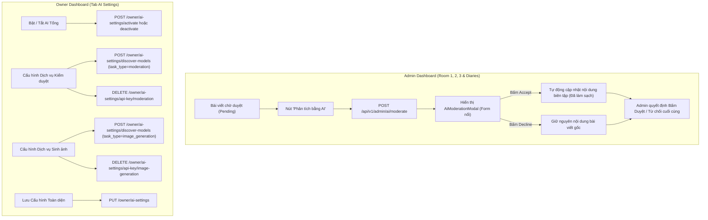

# THỰC THI 16 — TRANG QUẢN TRỊ: TÍCH HỢP AI COPILOT DUYỆT BÀI & QUẢN TRỊ CẤU HÌNH AI
## Tệp hướng dẫn tích hợp: `AdminPage`, `AdminPending`, `AdminDiaries`, `AiModerationModal`, `OwnerDashboardPage` (Tab AI)

---

## 1. Màn hình tương ứng & Vị trí mã nguồn
- **Màn hình Quản trị viên (Admin & Owner)**:
  - `Duyệt bài 3 phòng (Room 1, 2, 3)`: `src/pages/Admin/AdminPending.jsx`
  - `Duyệt Nhật ký cộng đồng`: `src/pages/Admin/AdminDiaries.jsx`
  - `Modal Form phân tích AI`: `src/components/Admin/AiModerationModal.jsx` (Component mới)
- **Màn hình Chủ sở hữu tối cao (Owner Dashboard)**:
  - `Bảng điều khiển Owner`: `src/pages/Owner/OwnerDashboardPage.jsx`
  - `Tab mới`: **"Cấu hình AI Copilot"** (AI Settings Tab)
- **Tệp dịch vụ API (Service)**: `src/services/aiCopilotService.js` (Tạo mới)
- **Tài liệu backend tham chiếu**: `backend/specification/plan_16_ai_copilot_moderation_and_generation.md`
- **Yêu cầu phân quyền**:
  - Nhóm API Kiểm duyệt & Sinh ảnh: Yêu cầu vai trò **`ADMIN`** hoặc **`OWNER`** (`Authorization: Bearer <token>`).
  - Nhóm API Cấu hình, Bật/Tắt & Xóa Key: Duy nhất vai trò **`OWNER`** mới được truy cập.

---

## 2. Tổng quan Kiến trúc Human-in-the-Loop & Tính độc lập Multi-Provider



---

## 3. Chi tiết Luồng Phân hệ 1: Admin & Owner Kiểm duyệt bài viết bằng AI

### 3.1 Vị trí nút "Phân tích bằng AI" trên giao diện Admin
- Tại mỗi tab: **Room 1 (Đổ vỡ)**, **Room 2 (Hy vọng)**, **Room 3 (Cây thông điệp)** trong `AdminPending.jsx` và tab **Diaries (Nhật ký)** trong `AdminDiaries.jsx`.
- Trong khung biên tập bài viết chi tiết bên phải (kế bên cụm nút **Duyệt bài** và **Từ chối / Reject**), bổ sung nút:
  - **Label**: `⚡ Phân tích bằng AI` (hoặc `AI Copilot`)
  - **Style**: Nút bấm gradient tím/xanh hiện đại, có icon tia chớp hoặc robot.

### 3.2 Đầu vào dữ liệu gửi lên API Kiểm duyệt
- Khi click nút `⚡ Phân tích bằng AI`, Frontend tổng hợp toàn bộ các trường nội dung của bài viết đang chọn:
  - `art_id`: ID của tác phẩm hoặc nhật ký (`id` hoặc `diary_id`).
  - `target_room`: Tên phòng tương ứng (`room1`, `room2`, `room3`, hoặc `diaries`).
  - `content`: Ghép nối đầy đủ thông tin:
    ```javascript
    const combinedContent = [
      currentArtwork.title && `Tiêu đề: ${currentArtwork.title}`,
      currentArtwork.short_content && `Mô tả ngắn: ${currentArtwork.short_content}`,
      currentArtwork.short_content_en && `Short description (EN): ${currentArtwork.short_content_en}`,
      currentArtwork.content && `Nội dung: ${currentArtwork.content}`,
      currentArtwork.content_en && `Content (EN): ${currentArtwork.content_en}`
    ].filter(Boolean).join("\n\n");
    ```
- **Endpoint**: `POST /api/v1/admin/ai/moderate`
- **Headers**: `Authorization: Bearer <adminToken>`, `Content-Type: application/json`
- **Request Body**:
  ```json
  {
    "art_id": "40de4fff-b48c-447d-be4e-8170e33e38ed",
    "target_room": "room1",
    "content": "Tiêu đề: Mùa thi năm ấy\n\nNội dung: Hôm nay tôi buồn vl khi chia tay nyc, liên hệ vay tiền 0981234567 nhé."
  }
  ```

### 3.3 Xử lý Mã lỗi Guard (HTTP 428 Precondition Required)
- Nếu tính năng AI đang tắt hoặc chưa cấu hình API Key, Backend trả về `HTTP 428`:
  ```json
  {
    "detail": "Tính năng AI đang tạm thời vô hiệu hóa bởi Quản trị viên tối cao (Owner)."
  }
  ```
- **Frontend xử lý**: Hiển thị Toast Warning màu vàng: *"Dịch vụ AI đang tắt hoặc chưa cấu hình API Key. Vui lòng liên hệ Quản trị viên tối cao (Owner) để kích hoạt."*

### 3.4 Modal Form nổi phân tích AI (`AiModerationModal.jsx`)
Khi API trả về `200 OK`, tự động mở Modal Form nổi với cấu trúc giao diện:

```
┌────────────────────────────────────────────────────────────────────────┐
│  ⚡ KẾT QUẢ PHÂN TÍCH NỘI DUNG TỪ AI COPILOT                     [✕]  │
├────────────────────────────────────────────────────────────────────────┤
│  Điểm đánh giá: [ 40 / 100 ]            Khuyến nghị: [ ✕ TỪ CHỐI ]     │
├────────────────────────────────────────────────────────────────────────┤
│  🏢 Đánh giá phòng: Room 1 (Hợp lệ)                                    │
│  "Nội dung chia tay phù hợp phòng Đổ Vỡ, tuy nhiên vi phạm PII..."     │
├────────────────────────────────────────────────────────────────────────┤
│  ⚠️ DANH SÁCH LỖI VI PHẠM (ĐÃ TRỪ 60 ĐIỂM):                            │
│  • [-25đ] Lộ thông tin cá nhân (PII)                                   │
│    - Dòng 1: "0981234567" ──> Lý do: Lộ số điện thoại liên lạc cá nhân  │
│  • [-20đ] Quảng cáo thương mại                                         │
│    - Dòng 1: "liên hệ vay tiền" ──> Lý do: Quảng cáo cho vay tài chính │
│  • [-15đ] Từ ngữ thô tục / Vi phạm chuẩn mực                           │
│    - Dòng 1: "buồn vl" ──> Lý do: Sử dụng teencode/từ lóng thô tục     │
├────────────────────────────────────────────────────────────────────────┤
│  ✨ ĐỀ XUẤT VIẾT LẠI TRUNG TÍNH (STRICT NO-HALLUCINATION):             │
│  ┌──────────────────────────────────────────────────────────────────┐  │
│  │ Hôm nay tôi buồn rất nhiều khi chia tay người yêu cũ.            │  │
│  │ [Đã ẩn thông tin liên hệ và quảng cáo vay vốn].                  │  │
│  └──────────────────────────────────────────────────────────────────┘  │
├────────────────────────────────────────────────────────────────────────┤
│                                  [ Decline - Giữ nguyên ] [ Accept - Áp dụng ]│
└────────────────────────────────────────────────────────────────────────┘
```

#### Xử lý 2 nút bấm trong Modal:
1. **Nút `Accept - Áp dụng`**:
   - Tự động thay thế nội dung trong ô nhập liệu/biên tập bài viết của Admin bằng `suggested_content`.
   - Đóng Modal.
   - Hiển thị Toast thành công: *"Đã cập nhật nội dung bài viết theo đề xuất làm sạch của AI."*
   - Admin có thể xem lại lần cuối trước khi bấm nút **Duyệt bài** chính thức.
2. **Nút `Decline - Giữ nguyên`**:
   - Đóng Modal.
   - Giữ nguyên toàn bộ nội dung nguyên bản của tác giả, không thay đổi bất kỳ trường dữ liệu nào.

---

## 4. Chi tiết Luồng Phân hệ 2: Owner Quản trị Cấu hình AI

### 4.1 Bổ sung Tab "Cấu hình AI" tại `OwnerDashboardPage.jsx`
- Trong danh sách các Tab quản trị của Owner (`Users & Admins`, `System Audit`,...), thêm Tab mới: **"Cấu hình AI Copilot"** (Icon `Cpu` hoặc `Sparkles`).
- Khi click vào Tab, gọi ngay: `GET /api/v1/owner/ai-settings`.
- **Dữ liệu trả về (200 OK)**:
  ```json
  {
    "success": true,
    "data": {
      "is_ai_enabled": true,
      "moderation": {
        "is_enabled": true,
        "provider": "gemini",
        "is_key_configured": true,
        "masked_api_key": "API_KEY",
        "model_name": "gemini-3-flash-preview",
        "base_url": null
      },
      "image_generation": {
        "is_enabled": true,
        "provider": "gemini",
        "is_key_configured": true,
        "masked_api_key": "API_KEY",
        "model_name": "imagen-3.0-generate-002",
        "base_url": null
      }
    }
  }
  ```

---

### 4.2 Công tắc Kích hoạt / Vô hiệu hóa AI toàn hệ thống
- **Giao diện**: Toggle Switch lớn ở đầu trang kèm badge trạng thái: `ĐANG BẬT` (Xanh lá) / `ĐÃ TẮT` (Xám).
- **Hành động**:
  - Khi bật switch: Gọi `POST /api/v1/owner/ai-settings/activate` với body `{"service": "all"}`.
  - Khi tắt switch: Gọi `POST /api/v1/owner/ai-settings/deactivate` với body `{"service": "all"}`.
- Hiển thị Toast thông báo thành công tương ứng.

---

### 4.3 Khung Cấu hình Dịch vụ Kiểm duyệt nội dung (`Moderation`)
Bao gồm các thành phần giao diện:
1. **Công tắc con**: Bật/Tắt riêng dịch vụ Kiểm duyệt (`is_moderation_enabled`).
2. **Nhà cung cấp (Provider)**: Dropdown chọn `Google Gemini`, `OpenAI`, `Anthropic Claude`, hoặc `Custom (Ollama/vLLM)`.
3. **Hiển thị API Key hiện tại**:
   - Nếu `is_key_configured === true`: Hiển thị chuỗi mask (vd: `API_KEY`) kèm badge xanh lá *"Đã cấu hình"*.
   - Nút đỏ bên cạnh: **"🗑️ Xóa API Key"**.
     - Khi bấm: Hiển thị hộp thoại xác nhận: *"Bạn có chắc chắn muốn xóa API Key kiểm duyệt này không?"*
     - Nếu xác nhận: Gọi `DELETE /api/v1/owner/ai-settings/api-key/moderation`.
     - Phản hồi: Cập nhật `is_key_configured = false`, xóa masked key.
4. **Nhập API Key mới**: Ô input password để nhập key mới khi cần thay đổi.
5. **Nút "Khám phá Model Động" (`Discover Models`)**:
   - Gọi API: `POST /api/v1/owner/ai-settings/discover-models`
   - Body: `{"api_key": newKey || currentKey, "provider": "auto", "task_type": "moderation"}`
   - Nhận danh sách model thật từ Google/OpenAI, tự động điền vào Dropdown model và chọn model có `is_recommended === true` (ví dụ: `gemini-3-flash-preview` hoặc `gpt-4o-mini`).
6. **Dropdown chọn Model Kiểm duyệt**: Liệt kê các model trả về kèm badge gợi ý.

---

### 4.4 Khung Cấu hình Dịch vụ Sinh ảnh nghệ thuật (`Image Generation`)
Bao gồm các thành phần:
1. **Công tắc con**: Bật/Tắt riêng dịch vụ Sinh ảnh (`is_image_gen_enabled`).
2. **Nhà cung cấp**: Dropdown `Google Imagen / Gemini`, `OpenAI DALL-E`, `Custom`.
3. **Hiển thị API Key hiện tại & Nút Xóa**:
   - Hiển thị masked key.
   - Nút **"🗑️ Xóa API Key"**: Gọi `DELETE /api/v1/owner/ai-settings/api-key/image-generation`.
4. **Nhập API Key mới**: Ô input password.
5. **Nút "Khám phá Model Động"**:
   - Gọi `POST /api/v1/owner/ai-settings/discover-models` với `task_type: "image_generation"`.
   - Tự động phát hiện và gợi ý `imagen-3.0-generate-002`, `dall-e-3`, `gemini-2.5-flash-image`.
6. **Dropdown chọn Model Sinh ảnh**: Cho phép Owner chọn engine mong muốn.

---

### 4.5 Nút Lưu Cấu hình Toàn diện (`Save Settings`)
- Khi Owner nhập key mới hoặc đổi model và bấm **"Lưu thay đổi"**:
- Gọi `PUT /api/v1/owner/ai-settings` với payload:
  ```json
  {
    "is_ai_enabled": true,
    "moderation": {
      "is_enabled": true,
      "provider": "gemini",
      "api_key": "API_KEY",
      "model_name": "gemini-3-flash-preview",
      "base_url": null
    },
    "image_generation": {
      "is_enabled": true,
      "provider": "gemini",
      "api_key": "API_KEY",
      "model_name": "imagen-3.0-generate-002",
      "base_url": null
    }
  }
  ```
- **Lưu ý**: Nếu trường `api_key` không thay đổi, truyền `null` hoặc bỏ trống để backend giữ nguyên khóa mã hóa cũ.

---

## 5. Tệp Dịch vụ Mã nguồn Mẫu: `src/services/aiCopilotService.js`

Lập trình viên tạo mới file `src/services/aiCopilotService.js` với đầy đủ các hàm sau:

```javascript
import apiClient from "./apiClient";

export const aiCopilotService = {
  // ==========================================
  // 1. DÀNH CHO ADMIN & OWNER: KIỂM DUYỆT & SINH ẢNH
  // ==========================================

  /**
   * Kiểm duyệt bài viết với Human-in-the-loop rubric scoring
   * @param {Object} data - { art_id, target_room, content }
   */
  moderateArtwork: async ({ art_id, target_room, content }) => {
    const res = await apiClient.post("/api/v1/admin/ai/moderate", {
      art_id,
      target_room,
      content,
    });
    return res.data;
  },

  /**
   * Sinh ảnh minh họa nghệ thuật từ cảm xúc bài viết
   * @param {Object} data - { art_id, source_content, custom_prompt_addon }
   */
  generateArtImage: async ({ art_id, source_content, custom_prompt_addon }) => {
    const res = await apiClient.post("/api/v1/admin/ai/generate-image", {
      art_id,
      source_content,
      custom_prompt_addon,
    });
    return res.data;
  },

  // ==========================================
  // 2. DÀNH RIÊNG CHO OWNER: QUẢN TRỊ CẤU HÌNH AI
  // ==========================================

  /**
   * Lấy cấu hình AI hiện tại
   */
  getAiSettings: async () => {
    const res = await apiClient.get("/api/v1/owner/ai-settings");
    return res.data;
  },

  /**
   * Khám phá model động từ API Key thật của Provider
   * @param {Object} data - { api_key, provider, task_type, base_url }
   */
  discoverModels: async ({ api_key, provider = "auto", task_type = "moderation", base_url = null }) => {
    const res = await apiClient.post("/api/v1/owner/ai-settings/discover-models", {
      api_key,
      provider,
      task_type,
      base_url,
    });
    return res.data;
  },

  /**
   * Cập nhật toàn bộ cấu hình AI Multi-Provider
   */
  updateAiSettings: async (payload) => {
    const res = await apiClient.put("/api/v1/owner/ai-settings", payload);
    return res.data;
  },

  /**
   * Kích hoạt dịch vụ AI (service: 'all' | 'moderation' | 'image_generation')
   */
  activateAiService: async (service = "all") => {
    const res = await apiClient.post("/api/v1/owner/ai-settings/activate", { service });
    return res.data;
  },

  /**
   * Vô hiệu hóa dịch vụ AI (service: 'all' | 'moderation' | 'image_generation')
   */
  deactivateAiService: async (service = "all") => {
    const res = await apiClient.post("/api/v1/owner/ai-settings/deactivate", { service });
    return res.data;
  },

  /**
   * Xóa API Key của dịch vụ kiểm duyệt
   */
  deleteModerationKey: async () => {
    const res = await apiClient.delete("/api/v1/owner/ai-settings/api-key/moderation");
    return res.data;
  },

  /**
   * Xóa API Key của dịch vụ sinh ảnh
   */
  deleteImageGenKey: async () => {
    const res = await apiClient.delete("/api/v1/owner/ai-settings/api-key/image-generation");
    return res.data;
  },
};

export default aiCopilotService;
```

---

## 6. Component Mẫu: `src/components/Admin/AiModerationModal.jsx`

```jsx
import React from "react";
import PropTypes from "prop-types";

export default function AiModerationModal({ isOpen, onClose, data, onAccept }) {
  if (!isOpen || !data) return null;

  const { score, verdict_recommendation, violations, room_assessment, suggested_content } = data;
  const isApprovedWithEdits = verdict_recommendation === "APPROVE_WITH_EDITS";

  return (
    <div className="fixed inset-0 z-50 flex items-center justify-center bg-black/70 backdrop-blur-sm p-4">
      <div className="relative w-full max-w-2xl max-h-[90vh] overflow-y-auto rounded-2xl bg-slate-900 border border-slate-700 shadow-2xl p-6 text-slate-100 flex flex-col gap-5">
        
        {/* Header */}
        <div className="flex items-center justify-between border-b border-slate-800 pb-4">
          <div className="flex items-center gap-2">
            <span className="text-xl">⚡</span>
            <h3 className="text-lg font-bold text-white">Kết quả phân tích từ AI Copilot</h3>
          </div>
          <button onClick={onClose} className="text-slate-400 hover:text-white text-lg">✕</button>
        </div>

        {/* Điểm số & Khuyến nghị */}
        <div className="flex items-center justify-between bg-slate-800/60 p-4 rounded-xl border border-slate-700/60">
          <div>
            <span className="text-xs uppercase text-slate-400 font-medium">Điểm đánh giá Rubric</span>
            <div className="text-3xl font-extrabold text-amber-400">{score} <span className="text-sm text-slate-400 font-normal">/ 100</span></div>
          </div>
          <div>
            <span className="text-xs uppercase text-slate-400 font-medium">Khuyến nghị của AI</span>
            <div className="mt-1">
              <span className={`px-3 py-1 rounded-full text-xs font-bold ${
                isApprovedWithEdits ? "bg-emerald-500/20 text-emerald-300 border border-emerald-500/30" : "bg-rose-500/20 text-rose-300 border border-rose-500/30"
              }`}>
                {isApprovedWithEdits ? "✓ PHÙ HỢP CẦN SỬA" : "✕ TỪ CHỐI BÀI VIẾT"}
              </span>
            </div>
          </div>
        </div>

        {/* Đánh giá phòng */}
        {room_assessment && (
          <div className="text-sm bg-indigo-950/40 border border-indigo-800/40 p-3 rounded-lg">
            <span className="font-semibold text-indigo-300">🏢 Đánh giá phòng ({room_assessment.current_room}): </span>
            <span className="text-slate-300">{room_assessment.reason}</span>
          </div>
        )}

        {/* Danh sách lỗi vi phạm */}
        <div>
          <h4 className="text-xs font-semibold uppercase text-slate-400 mb-2">Các vi phạm phát hiện ({violations.length})</h4>
          {violations.length === 0 ? (
            <p className="text-sm text-emerald-400 italic">Không phát hiện vi phạm chính sách.</p>
          ) : (
            <div className="space-y-2">
              {violations.map((v, idx) => (
                <div key={idx} className="flex items-start gap-3 p-3 bg-rose-950/20 border border-rose-900/30 rounded-lg text-sm">
                  <span className="px-2 py-0.5 rounded bg-rose-500/20 text-rose-300 text-xs font-bold shrink-0">
                    -{v.deducted_points}đ
                  </span>
                  <div className="flex-1">
                    <div className="text-slate-200">
                      <span className="font-medium text-rose-300">"{v.quote}"</span>
                      {v.line_number && <span className="text-slate-400 text-xs ml-2">(Dòng {v.line_number})</span>}
                    </div>
                    <div className="text-slate-400 text-xs mt-0.5">{v.reason}</div>
                  </div>
                </div>
              ))}
            </div>
          )}
        </div>

        {/* Bản đề xuất viết lại trung tính */}
        <div>
          <h4 className="text-xs font-semibold uppercase text-slate-400 mb-2">Đề xuất nội dung đã làm sạch (Strict No-Hallucination)</h4>
          <div className="p-3 bg-slate-950 border border-slate-800 rounded-lg text-sm text-slate-300 leading-relaxed max-h-36 overflow-y-auto">
            {suggested_content || "Không có đề xuất thay đổi."}
          </div>
        </div>

        {/* Nút hành động */}
        <div className="flex items-center justify-end gap-3 pt-4 border-t border-slate-800">
          <button
            onClick={onClose}
            className="px-4 py-2 text-sm rounded-lg bg-slate-800 hover:bg-slate-700 text-slate-300 transition"
          >
            Decline - Giữ nguyên
          </button>
          <button
            onClick={() => onAccept(suggested_content)}
            className="px-5 py-2 text-sm rounded-lg bg-gradient-to-r from-amber-500 to-indigo-600 hover:from-amber-600 hover:to-indigo-700 text-white font-medium shadow-lg transition"
          >
            Accept - Áp dụng đề xuất AI
          </button>
        </div>

      </div>
    </div>
  );
}

AiModerationModal.propTypes = {
  isOpen: PropTypes.bool.isRequired,
  onClose: PropTypes.func.isRequired,
  data: PropTypes.object,
  onAccept: PropTypes.func.isRequired,
};
```

---

## 7. Bảng Kiểm Tra Hoàn Tất (Testing Checklist)
1. **Admin / Owner duyệt bài (Room 1, 2, 3 & Diaries)**:
   - [ ] Bấm nút `⚡ Phân tích bằng AI` hiển thị loading spinner.
   - [ ] Modal nổi lên đầy đủ điểm số, trích dẫn lỗi cụ thể, lý do.
   - [ ] Bấm `Accept`: Tự động thay thế nội dung trong ô biên tập bằng `suggested_content`.
   - [ ] Bấm `Decline`: Giữ nguyên bài viết gốc của người dùng.
2. **Owner quản trị cấu hình AI**:
   - [ ] Bật/tắt công tắc tổng AI: Gọi `/activate` và `/deactivate` thành công.
   - [ ] Nhập API key mới bấm `Khám phá Model Động`: Tự động nhận diện provider và hiển thị danh sách model thật để chọn.
   - [ ] Bấm nút `Xóa API Key`: Xóa key khỏi database, đưa `is_key_configured` về `false`.
   - [ ] Bấm `Lưu thay đổi`: Cập nhật thành công vào database qua `PUT /owner/ai-settings`.
